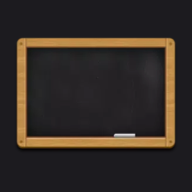

<p align="center">
  
</p>

<h1 align="center">Pickup Board – Taxi &amp; Chauffeur</h1>

<p align="center">
  <strong>Free digital airport pickup sign for taxi, limousine &amp; chauffeur drivers.</strong><br>
  Maximum-size auto-fitting passenger names without mid-word breaks — works 100% offline on iPhone, iPad, Android &amp; Desktop.
</p>

<p align="center">
  <a href="https://tommy-rk.github.io/pickup-board/"><strong>Launch Web App (PWA)</strong></a>
  &nbsp;•&nbsp;
  <a href="https://play.google.com/store/apps/details?id=de.kuczek.pickupboard"><strong>Get Android App on Google Play</strong></a>
</p>

---

## Key Features

* **Maximum Readability Without Mid-Word Breaks:** Automatically calculates the largest possible font size across `Auto`, `1 Line`, `2 Lines`, or `3 Lines` while keeping every word intact.
* **5 High-Contrast Themes:** *Airport Signal* (Yellow/Black), *OLED Black*, *Daylight*, *Night Mode* (warm amber), and the classic *Chalkboard* with wooden frame.
* **Custom Company Logo & Icons:** Choose built-in Taxi, Airport, VIP, or Hotel icons — or upload your own company logo directly from your photo library.
* **100% Offline Ready (PWA):** Works reliably inside airport terminals and underground garages without mobile reception, and keeps the display awake via the Screen Wake Lock API.
* **21 Languages Built In:** Automatically matches your device language (English, German, Spanish, French, Italian, Portuguese, Dutch, Polish, Turkish, Arabic, Chinese, Japanese, Hindi, Korean, Russian, Ukrainian, Greek, Thai, Indonesian, Vietnamese, and Romanian).
* **Recent Passengers History:** Quick-select chips for the last 5 passengers including flight number or company details.

---

## Install on iPhone & iPad (Free, Fullscreen & Offline)

1. Open **[https://tommy-rk.github.io/pickup-board/](https://tommy-rk.github.io/pickup-board/)** in **Safari**.
2. Tap the **Share** button → **Add to Home Screen**.
3. Launch **Pickup Board** directly from your Home Screen — fullscreen, offline-capable, and ready in 1 second.

> **Using Android?** Download the native **[Pickup Board app on Google Play](https://play.google.com/store/apps/details?id=de.kuczek.pickupboard)** for automatic 100% display brightness and the built-in offline camera OCR name scanner.

---

## Magic Board Links (For Dispatchers & WhatsApp)

Send a ready-to-display pickup board link directly to a chauffeur via WhatsApp or SMS — tapping the link opens the fullscreen sign immediately:

```text
https://tommy-rk.github.io/pickup-board/?name=Peter+Wolf&sub=LH+402&theme=airport&show=1
```

| Parameter | Values | Description |
| :--- | :--- | :--- |
| `name` | Any text | Passenger name (e.g. `Peter+Wolf`) |
| `sub` / `flight` | Any text | Optional flight number, company, or note (e.g. `LH+402`) |
| `theme` | `airport`, `oled`, `daylight`, `night`, `chalkboard` | Optional color theme |
| `lines` | `auto`, `1`, `2`, `3` | Optional line layout |
| `show` | `1` | Opens fullscreen board immediately |
